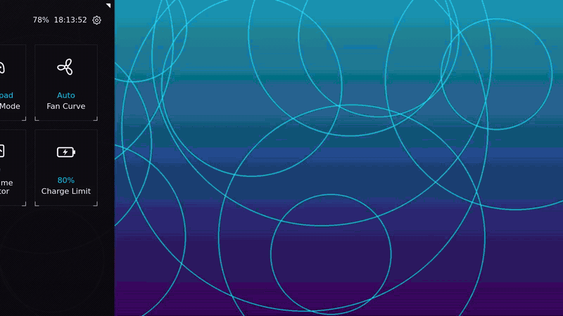
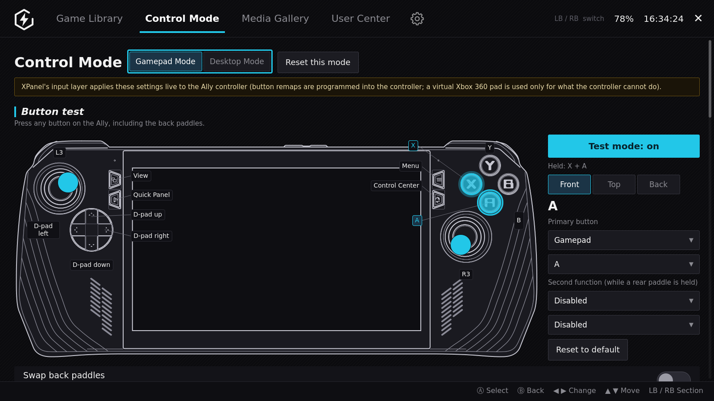
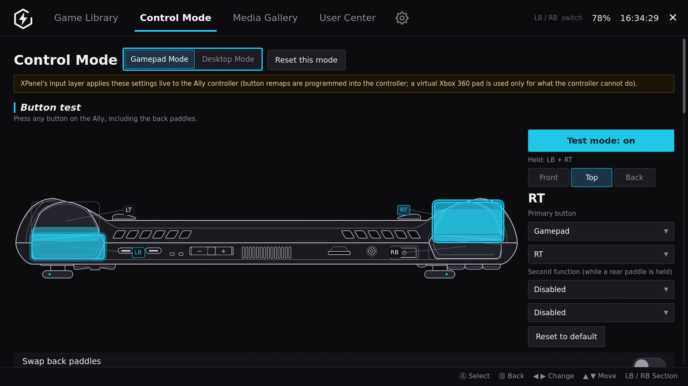
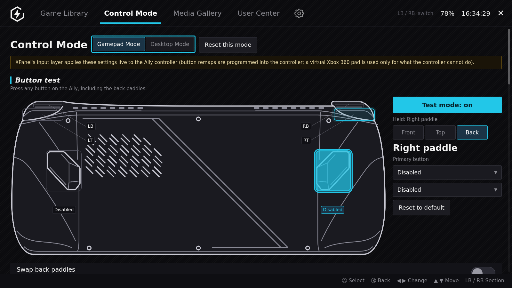
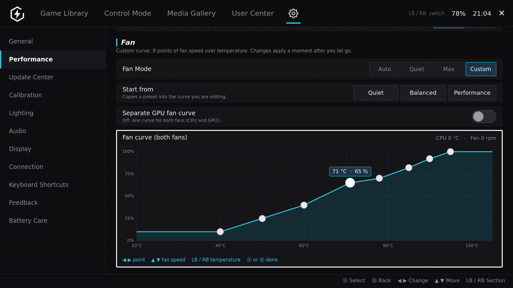
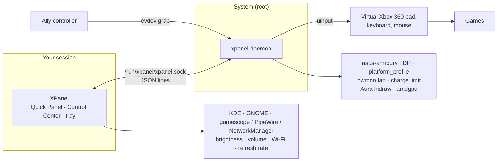

<div align="center">


# XPanel

### The Armoury Crate experience for the ROG Ally X and ROG Ally — on Linux.

<sub>ROG Xbox Ally and ROG Xbox Ally X: experimental, untested on hardware.</sub>

Press the Ally button: a **Quick Panel** slides in with Operating Mode, fan, charge limit,
lighting and more. Open the full **Control Center** for your game library, controller
mapping, performance tuning and battery care. Native C++ / Qt 6, made for KDE Plasma
(GNOME and Steam Game Mode: experimental).

[](https://github.com/Adhamura/XPanel/actions/workflows/ci.yml)
[](https://github.com/Adhamura/XPanel/releases)
[](LICENSE)
-informational)
-red)
-1d99f3)


[**Download**](https://github.com/Adhamura/XPanel/releases/latest) ·
[Screenshots](#screenshots) · [Why XPanel](#why-xpanel) · [Install](#install) · [FAQ](#faq)



</div>

> [!NOTE]
> **Not affiliated with ASUS.** XPanel is an independent open-source project. ASUS, ROG, ROG Ally
> and Armoury Crate are trademarks of ASUSTeK Computer Inc. and are used only to name the hardware
> and the Windows app that XPanel's layout follows.

## Why XPanel

On Windows the ROG Ally has **Armoury Crate**. On Linux there is no Armoury Crate, and the
alternatives are either inside Steam's Game Mode or a set of separate tools. XPanel brings the
familiar Armoury Crate layout to the Linux desktop as one app:

- **🎮 One button, everything there.** The Ally's menu button opens a Quick Panel over your game,
  fully driven by the gamepad (D-pad, A, B, LB/RB). No mouse, no Steam overlay needed.
- **⚡ Operating Modes like on Windows.** Silent 13 W · Performance 17 W · Turbo 25 W
  (**30 W on the charger**) · Manual with separate SPL / SPPT / FPPT. On the original ROG Ally:
  Silent 10 W · Performance 15 W · Turbo 25 W (30 W on the charger), as ASUS sets them.
  **Lock boost to SPL** keeps SPPT / FPPT at the Manual watts, so the chip never draws more.
- **🧮 CPU and GPU clocks, your call.** Quick Panel tiles for the CPU and GPU clock: Auto (the
  driver decides), a Range (minimum and maximum) or one Fixed clock. Cap the CPU to keep it cool,
  or keep the GPU from idling at 800 MHz. The Real-time Monitor shows both clocks live.
- **🔌 Settings that stay set.** The daemon re-applies your mode when you plug or unplug the
  charger, and when the firmware or another tool changes the TDP behind your back.
- **🗂️ A real Control Center.** Game Library with per-game mode, TDP, fan and control preset,
  applied when the game starts (also from Steam) and undone when it ends; Media Gallery for your
  screenshots and clips; Settings for performance, lighting, audio, display, connections,
  shortcuts, updates and battery care.
- **🕹️ Its own controller layer.** Remap every button, add a second function while a back paddle
  is held, button repeat, stick and trigger curves, vibration strength, and a Desktop Mode that
  turns the pad into mouse and keyboard. Applied live, no InputPlumber or hhd needed.
- **🔋 Battery care.** Charge limit (e.g. 80 %), battery health, capacity and charge cycles.
- **🌈 Aura lighting.** Static, breathing, dual breathing (two colors), color cycle, rainbow
  (with a direction), strobe, and two effects that follow the system: battery level (red to
  green) and Operating Mode (blue Silent, white Performance, red Turbo). The new effects are not
  tested on hardware yet.
- **🌀 Custom fan curve.** Settings › Performance › Fan Mode › Custom: an 8-point graph (fan
  speed over temperature) you drag with touch or mouse, or edit with the D-pad (Ⓐ, ◀ ▶ point,
  ▲ ▼ fan speed, LB / RB temperature). Start from Quiet, Balanced or Performance; one curve for
  both fans or a separate GPU curve. Saved, re-applied after TDP changes, and added to the Quick
  Panel fan tile once saved.
- **🎯 Gyro aiming.** The Ally's motion sensor as a mouse or added to the right stick, with
  sensitivity, turning axis, invert, "only while LT is held" and calibration.
- **🖥️ Brightness for every screen.** External monitor only, Ally only, or one bar per screen
  when the desktop is extended.
- **🌍 10 languages, three desktops.** English, Deutsch, Español, Français, Italiano, 日本語,
  한국어, Português (Brasil), Русский, 简体中文. Made for KDE Plasma; GNOME and Steam Game Mode
  work too (experimental).
- **🪶 Native and small.** About 11k lines of C++17 / QML. No Python, Electron or web runtime.
  A small root daemon on a local socket does the hardware work.

## Screenshots

<table>
  <tr>
    <td width="50%"><br><b>Game Library</b> — Steam and installed apps, per-game Operating Mode, TDP and controls</td>
    <td width="50%"><br><b>Performance</b> — Operating Mode, live applied limits, manual SPL / SPPT / FPPT, Eco Mode, CPU Boost, GPU clock and memory</td>
  </tr>
  <tr>
    <td><br><b>Control Mode</b> — key map, front: test mode shows held buttons (X + A) and both sticks; the side panel assigns the selected button</td>
    <td><br><b>Key map, top edge</b> — bumpers and triggers; the trigger fills as you pull it (LT a third, RT most of the way)</td>
  </tr>
  <tr>
    <td><br><b>Key map, back</b> — the rear paddles (as held), primary and paddle-held second functions</td>
    <td><br><b>Lighting</b> — Aura effects (also dual breathing, strobe, battery level, follow Operating Mode), colors and brightness</td>
  </tr>
  <tr>
    <td><br><b>Battery Care</b> — charge limit, battery health, cycles, power options</td>
    <td><br><b>Media Gallery</b> — screenshots and recordings: open, share, show in folder, delete</td>
  </tr>
  <tr>
    <td><br><b>Fan Curve</b> — 8-point custom curve, editable by touch or gamepad, separate GPU curve</td>
    <td><br><b>Update Center</b> — XPanel itself (GitHub releases), system packages, device firmware (fwupd) and the Ally X BIOS from ASUS</td>
  </tr>
  <tr>
    <td colspan="2"><br><b>Quick Panel</b> — opens over the game with the Ally button: Operating Mode, Control Mode, fan, keyboard, monitor, charge limit, lighting, brightness and volume</td>
  </tr>
</table>

<sub>Screenshots and the demo are made with demo data (made-up games) by <code>tools/screenshots/capture.sh</code> and <code>tools/screenshots/demo.sh</code>.</sub>

## How it compares

| | **XPanel** | Handheld Daemon (hhd) | Decky TDP plugins | asusctl / ROG Control Center | Armoury Crate |
|---|:--|:--|:--|:--|:--|
| Runs on Linux | ✅ | ✅ | ✅ | ✅ | ❌ Windows only |
| Armoury Crate–style Quick Panel + Control Center | ✅ | ➖ | ❌ | ➖ | ✅ |
| Opens on the Ally button in the **desktop** (KDE; GNOME experimental) | ✅ | ➖ | ❌ | ❌ | — |
| Works without Steam / Game Mode | ✅ | ✅ | ❌ | ✅ | — |
| Operating Modes + manual SPL / SPPT / FPPT | ✅ | ✅ | ✅ | ➖ | ✅ |
| Re-applies TDP on charger plug / unplug | ✅ | ➖ | ➖ | ➖ | — |
| Charge limit | ✅ | ✅ | ➖ | ✅ | ✅ |
| Aura lighting | ✅ | ✅ | ➖ | ➖ | ✅ |
| Custom fan curve editor | ✅ | ✅ | ❌ | ✅ | ✅ |
| Gyro as mouse / right stick | ✅ | ✅ | ❌ | ❌ | ✅ |
| Button remapping, paddle-held second functions | ✅ | ➖ | ❌ | ❌ | ✅ |
| Game Library with per-game profiles | ✅ | ❌ | ➖ | ❌ | ✅ |
| Media Gallery | ✅ | ❌ | ❌ | ❌ | ✅ |
| Native app, no Python / web runtime | ✅ | ❌ | ❌ | ✅ | — |
| Steam Game Mode (gamescope) | ➖ experimental (pad only, no touch) | ✅ | ✅ | ➖ | — |

<sub>✅ yes · ➖ partial, or depends on setup · ❌ no. Based on each project's public documentation;
corrections are welcome in an issue. hhd is great in Steam Game Mode — XPanel is for people who
use the Ally as a <b>Linux desktop</b> and miss Armoury Crate.</sub>

## Requirements

- **ROG Ally X** (RC72LA) or **ROG Ally** (RC71L, Z1 / Z1 Extreme). The original Ally has its
  own Operating Mode wattages, power limits and controller support, but is not yet tested on
  hardware: please [report issues](https://github.com/Adhamura/XPanel/issues/new/choose).
- **ROG Xbox Ally** (RC73YA, Ryzen Z2 A) and **ROG Xbox Ally X** (RC73XA, Ryzen AI Z2 Extreme):
  **experimental, untested on hardware** — please report what works and what doesn't. Detected
  by DMI board name; their controller is the same USB device as the Ally X's (`0b05:1b4c`).
  The Xbox Ally X has `asus-armoury` power ranges in the kernel; for the Xbox Ally XPanel uses
  the Ryzen Z2 A's 6–20 W.
- **Linux x86_64** with **KDE Plasma 6** (Wayland or X11) — recommended, everything works there.
  Developed on CachyOS; Arch, Fedora KDE and other Plasma 6 distros should work.
  **GNOME** and **Steam Game Mode** (gamescope: SteamOS, Bazzite, ChimeraOS) are experimental,
  see [Desktops](#desktops).
- A kernel with the **`asus-armoury`** driver (e.g. the CachyOS kernel) for TDP and BIOS settings.
- **Qt 6** (≥ 6.8 for the release archive, ≥ 6.5 from source), `layer-shell-qt` for the Wayland overlay.
- Optional, for the matching tiles and settings: `wireplumber` (`wpctl`), NetworkManager,
  `bluez-utils`, `kscreen`, `spectacle`, `fwupd`, `pacman-contrib`; outside KDE also
  `gnome-screenshot` (GNOME) and `ddcutil` (external monitor brightness).
- Japanese, Korean and Chinese need a CJK font on the system (for example Noto Sans CJK; Windows has
  them). To build from source with translations, Qt's Linguist tools (`qt6-tools` on Arch,
  `qt6-l10n-tools` + `qt6-tools-dev` on Debian) are needed; without them XPanel builds in English only.

### Desktops

XPanel finds out where it runs from `XDG_CURRENT_DESKTOP` (and `GAMESCOPE_WAYLAND_DISPLAY`,
`XDG_SESSION_DESKTOP`); `XPanel --desktop` prints the result, `XPANEL_DESKTOP=kde|gnome|gamescope|other`
overrides it. Controls that a desktop cannot do are hidden, with a short note in Settings.
The hardware part (Operating Mode, TDP, fan, charge limit, lighting, controller layer, gyro) is
the root daemon's and works the same everywhere.

| | KDE Plasma 6 | GNOME (experimental) | Steam Game Mode (experimental) |
|---|:--|:--|:--|
| Quick Panel window | Wayland layer-shell overlay (X11 too) | XWayland window, full screen, kept above | gamescope external overlay (XWayland) |
| Ally buttons, gamepad navigation | ✅ | ✅ | ✅ (touch / mouse go to the game) |
| Brightness | ✅ KDE service, internal + DDC/CI monitors | ✅ internal (logind); monitors with `ddcutil` | ✅ internal (logind) |
| Volume, Wi-Fi, Bluetooth, sensors | ✅ | ✅ | ✅ |
| Refresh rate, Display Mode, wide colour | ✅ `kscreen-doctor` | ❌ hidden | ❌ hidden (Steam's display settings) |
| Colour presets | ✅ KWin Night Color | ✅ Night Light (always on, via `gsettings`) | ❌ hidden |
| On-screen keyboard | ✅ KWin keyboard (Steam's as fallback) | ✅ GNOME screen keyboard on / off | ✅ Steam's keyboard |
| Screenshot tile | ✅ Spectacle | ✅ with `gnome-screenshot` | ❌ hidden (Steam + R1) |
| Show Desktop tile | ✅ | ❌ hidden | ❌ hidden |
| Log out | ✅ | ✅ (GNOME's dialog) | ❌ hidden (Steam's power menu) |
| Global keyboard shortcuts | ✅ kglobalaccel | ➖ bind `XPanel --toggle` yourself | ❌ |
| Tray icon | ✅ | ➖ needs the AppIndicator extension | ❌ none |
| Autostart | XDG autostart | XDG autostart | systemd user unit `xpanel.service` |

Other desktops (Sway, Hyprland, …) get the generic path: layer-shell if the compositor has it,
logind brightness, `xdg-open` and `x-terminal-emulator`, no KDE-only controls.

<details>
<summary>Why XWayland on GNOME, and how the Game Mode overlay works</summary>

- **GNOME:** Mutter has no `wlr-layer-shell`, and a normal Wayland window cannot place itself or
  stay above others. On GNOME XPanel therefore runs on XWayland (`QT_QPA_PLATFORM=xcb`, when
  `DISPLAY` is set), where a frameless "keep above" window covering the screen works. The trade-off:
  XWayland scaling on HiDPI can look soft, and GNOME may show "XPanel is ready" instead of giving
  it keyboard focus; the gamepad works regardless (it goes through xpanel-daemon).
  `XPANEL_BACKEND=wayland` keeps it on Wayland (no overlay).
- **Steam Game Mode:** apps run on gamescope's XWayland. XPanel sets the X11 property
  `GAMESCOPE_EXTERNAL_OVERLAY = 1` (CARDINAL) on the window it shows — the Quick Panel, the
  Control Center or the Real-time Monitor, one at a time — and gamescope draws it above the game,
  as it does for MangoHud. Overlays never get input focus in gamescope: the panel is driven with
  the Ally's buttons and pad through xpanel-daemon; touch and mouse reach the game. Built with
  libxcb (`XPANEL_WITH_XCB`, on by default).
</details>

**Windows 10 / 11 x64 (experimental):** Operating Mode / TDP, fan, charge limit, Aura lighting
and boot sound through the ASUS System Control Interface (installed on every Ally). Since 1.6
also controller remapping (programmed into the Ally's controller), gyro, the Ally buttons, system
tiles, brightness and volume, the Update Center for ASUS BIOS / firmware / drivers. There is **no 32-bit build**: the Ally is a 64-bit device.

## Install

### One file: AppImage (recommended)

Download **`XPanel-<version>-x86_64.AppImage`** from
[**Releases**](https://github.com/Adhamura/XPanel/releases/latest). It contains everything,
Qt included, and works on any x86_64 distro from 2024 on (glibc ≥ 2.39: CachyOS, Arch, Fedora 40+,
Bazzite, Ubuntu 24.04+, Debian 13, …).

```bash
chmod +x XPanel-*-x86_64.AppImage
sudo ./XPanel-*-x86_64.AppImage --install --disable-hhd   # app, tray icon, menu entry, root service
```

`--install` copies XPanel to `/opt/xpanel`, sets up the root service and the `xpanel` group,
adds a menu entry, autostart and the `xpanel` command; `--disable-hhd` stops hhd (it changes the
same hardware); `--game-mode` also starts XPanel in Steam Game Mode (see below). Remove
everything with `sudo xpanel --uninstall`.
You can also just run the file (`./XPanel-*-x86_64.AppImage`) to try the app; hardware settings
need the installed service.

### Steam Game Mode autostart (experimental)

gamescope sessions (SteamOS, Bazzite, ChimeraOS Game Mode) don't run the desktop autostart
entries. Every install method also installs a systemd **user** unit, `xpanel.service`, that starts
XPanel in Game Mode only (it checks `XPanel --is-game-mode` first, so it does nothing in a desktop
session, where the autostart entry starts XPanel; a second start would just hand over to the
running one). It is not enabled by default:

```bash
systemctl --user enable --now xpanel.service     # your user
sudo systemctl --global enable xpanel.service    # every user (what the AppImage's --game-mode does)
scripts/install.sh --game-mode                   # release archive / source install: enable it too
```

If it does not start, check `systemctl --user status xpanel.service` and that the session exports
`XDG_CURRENT_DESKTOP=gamescope` (or `GAMESCOPE_WAYLAND_DISPLAY`) to the user manager
(`systemctl --user show-environment`).

### Windows (experimental)

Run **`XPanel-<version>-Windows-x64-Setup.exe`** from
[**Releases**](https://github.com/Adhamura/XPanel/releases/latest). XPanel starts in the tray;
open the Quick Panel with a click on the tray icon or **Win+Shift+Q**, the Control Center with
**Win+Shift+C**. Close Armoury Crate while you use XPanel: both change the same settings.

### Release archive (uses your system's Qt)

`xpanel-<version>-linux-x86_64.tar.gz` needs Qt ≥ 6.8 and layer-shell-qt from your distro
(Arch / CachyOS: `sudo pacman -S qt6-base qt6-declarative qt6-svg layer-shell-qt`):

```bash
tar xzf xpanel-*-linux-x86_64.tar.gz && cd xpanel-*-linux-x86_64
scripts/install.sh                             # app, tray icon, autostart (your user)
sudo scripts/install-daemon.sh --disable-hhd   # root service; stops hhd (it changes the same hardware)
```

Check downloads with `sha256sum -c SHA256SUMS --ignore-missing`.

### Arch / CachyOS package

```bash
cd packaging/arch && makepkg -si
sudo systemctl enable --now xpanel-daemon
sudo usermod -aG xpanel $USER                  # allow your user to control the daemon
```

### From source

```bash
./run.sh --version                             # build (CMake + Ninja), then print the version
scripts/install.sh
sudo scripts/install-daemon.sh --disable-hhd
```

Run from the source folder without installing: `./run.sh`.
Remove: `scripts/uninstall.sh` and `sudo scripts/uninstall-daemon.sh`.

### Build a release archive yourself

```bash
./build-release.sh               # this system's Qt → dist/: AppImage, .tar.gz, SHA256SUMS
./build-release.sh --container   # builds in debian:trixie with Docker / Podman, like CI
```

On Windows, `build-release.bat` builds the Windows installer
(`dist\XPanel-<version>-Windows-x64-Setup.exe`; needs Qt 6 for MSVC, Visual Studio 2022 C++
tools, CMake, Ninja and Inno Setup 6), and `build-release.bat --linux` builds the Linux files in WSL.

**Releases are automatic.** Bump `project(VERSION)` in `CMakeLists.txt`, add a `## <version>`
section to `CHANGELOG.md` and merge to `main`: GitHub Actions builds the AppImage and the archive,
starts the AppImage on a virtual screen to catch missing plugins or QML errors, and publishes the
release `v<version>` with the changelog section as notes.

### Updates

XPanel looks for a new release **once a day** (and a minute after it starts): it asks
`api.github.com` for this repository's latest release. Nothing else is sent (no ID, no
statistics), and **Settings › Update Center › Check for updates automatically** turns it off;
"Check now" still works. When there is a new version, the tray shows a message, the User Center
lists it and Settings gets a dot; the Update Center shows the release notes, **Update now** and
**Skip this version**. How it updates depends on how XPanel was installed:

- **AppImage installed with `--install`** (`/opt/xpanel`): downloads the new AppImage and runs
  `pkexec <new AppImage> --install` (the system asks for your password), which replaces
  `/opt/xpanel`, rewrites the services and restarts `xpanel-daemon`; then **Restart XPanel**.
  `--game-mode` is passed again when it was used before. Without a password prompt (Steam Game
  Mode has no polkit agent) or without `pkexec`, it shows the `sudo … --install` command to run in
  a terminal, with a Copy button.
- **AppImage you just run**: saves the new AppImage next to the old one (which is kept), then
  **Restart XPanel** starts the new file.
- **Windows**: runs the new Setup silently (Windows asks for permission); XPanel closes and starts
  again when the installer is done.
- **Release archive, Arch package or source build**: no automatic install; the Update Center
  shows the new version and links the release page (packages: update with your package manager).

Every download comes from `github.com` / `*.githubusercontent.com` over HTTPS (redirects
included) and is checked against the release's **`SHA256SUMS`**; a file that does not match, or
is not listed, is not installed.

## Using XPanel

| Pad | Keyboard | Action |
|---|---|---|
| Left menu button (or right, from the tray menu) | Meta+Shift+Q (KDE) | open / close the Quick Panel |
| D-pad | Arrows | move |
| A | Enter / Space | change the tile value / select |
| B | Esc | back / close |
| X | — | open the Control Center (Settings) |
| Y | E | edit the Quick Panel tiles |
| LB / RB | PgUp / PgDn | volume (panel) · switch section (Control Center) |

Tiles change on each press (Silent → Performance → Turbo → Manual → Silent). Manual TDP, CPU Clock
and GPU Clock open a pop-up instead: ▲ ▼ pick a row, ◀ ▶ change a value (or tap the arrows), A on
**Mode** switches Auto → Range → Fixed, A on **Lock boost to SPL** turns the lock on or off. The Control Center
also opens from the gear icon, the tray menu, Meta+Shift+C or `XPanel --app [page]`, where page
is `library`, `control`, `gallery`, `user`, `settings` or `settings/<section>`.
Settings are kept in `~/.config/XPanel/config.json`.

Fan curve graph (Settings › Performance › Fan Mode › Custom): drag a point with touch or mouse.
With the pad, A on the graph starts editing, then ◀ ▶ pick a point, ▲ ▼ change its fan speed
(5 %), LB / RB its temperature (1 °C; keyboard PgUp / PgDn), A or B ends. The fan tile on the
Quick Panel cycles Auto → Quiet → Max → Custom (Custom once a curve is saved); the lighting tile
cycles through all effects.

## How it works



| Part | Runs as | Does |
|---|---|---|
| `XPanel` (`src/`, `qml/`) | user | Quick Panel, Control Center, tray icon; brightness, volume, refresh rate, radios, sensors |
| `xpanel-daemon` (`daemon/`) | root (systemd) | Operating Mode / TDP, fan, charge limit, lighting, input layer; saves and restores them |

<details>
<summary>Hardware interfaces and daemon protocol</summary>

- **Operating Mode / TDP:** `/sys/firmware/acpi/platform_profile` and
  `/sys/class/firmware-attributes/asus-armoury/attributes/ppt_pl{1,2,3}_*`.
  The watt values per mode are our choice, close to the ASUS defaults on Windows; they and the
  fallback power ranges live in one table per model (`daemon/Model.h`, found by the DMI board
  name). Manual limits are clamped to the `min_value` / `max_value` the driver reports.
- **Fan:** hwmon `asus_custom_fan_curve` (Auto = firmware curve, Quiet, Max, Custom: 8 temperature /
  duty points per fan from the `fanCurve` key; checked in `daemon/FanCurve.h`, temperatures
  20..105 °C rising, duty 0..100 % never falling). Windows: the same 8 + 8 bytes through the
  ATKACPI fan curve devices.
- **Charge limit:** `BAT0/charge_control_end_threshold`.
- **Lighting:** ASUS Aura HID output reports (report id `0x5A`) on the N-KEY hidraw node with
  vendor usage page `0xFF31`; the packets are built in `daemon/Aura.h`. Battery level and
  Operating Mode lighting are a static color the daemon recomputes (every 5 % of charge, on a
  mode change).
- **Input layer:** the daemon grabs the Ally pad and N-KEY keyboard (USB `0b05:1b4c` on the
  Ally X and the ROG Xbox Ally / Xbox Ally X, `0b05:1abe` on the Ally; nodes picked by their
  capabilities, never a virtual device or an external pad) with evdev and sends a
  virtual Xbox 360 pad, keyboard and mouse through uinput, with the mapping from Control Mode.
  While the Quick Panel is open, the pad drives XPanel instead of the game. The raw pad nodes are
  hidden from games while the daemon runs and restored by udev when it stops.
- **Gyro:** the Bosch BMI323 through the kernel IIO driver (`/sys/bus/iio/devices/iio:deviceN`,
  name `bmi323-imu`), rotated by its mount matrix. The daemon reads it through the IIO buffer
  (`/dev/iio:deviceN`, the sensor's data-ready trigger, 200 Hz) or, without a trigger, by polling
  `in_anglvel_*_raw` at 125 Hz — only while gyro is on and a game has the pad — and puts the
  buffer and sampling rate back when it stops. The calibration offset is kept in the daemon's
  state (`gyroBias`).
- **Desktop** (`src/Desktop.*` decides what is used where): KDE brightness D-Bus, KWin,
  kglobalaccel, `kscreen-doctor`, `spectacle`; logind `SetBrightness` and `/sys/class/backlight`,
  `ddcutil`, GNOME `gsettings` (Night Light, screen keyboard) and `org.gnome.SessionManager`,
  gamescope's `GAMESCOPE_EXTERNAL_OVERLAY`; everywhere `wpctl`, `nmcli`, `bluetoothctl`.

Protocol on `/run/xpanel/xpanel.sock`, one JSON object per line:
`{"get":true}`, `{"set":{"opmode":"turbo"}}` → `{"state":{...}}` (also pushed on each change).
See the top of `daemon/main.cpp` for all keys.
</details>

## FAQ

**Does it work on Windows?** Partly, and experimentally: the installer sets Operating Mode / TDP,
fan (including a custom curve), charge limit, lighting and boot sound the way Armoury Crate does.
Since 1.6 also controller remapping, gyro, the Ally buttons and the system tiles. XPanel is made first for Linux, where there is no
Armoury Crate.

**Does it conflict with Handheld Daemon (hhd), InputPlumber or Decky TDP plugins?** Yes, they
change the same hardware. `install-daemon.sh --disable-hhd` stops hhd, and `uninstall-daemon.sh`
tells you how to turn it back on. Don't run a Decky TDP plugin at the same time. If InputPlumber
holds the controller, Control Mode shows it as busy.

**Does it work in Steam Game Mode (Bazzite / SteamOS / ChimeraOS)?** Experimentally, since 1.3. Enable the user unit (`systemctl --user enable xpanel.service`, see
[Steam Game Mode autostart](#steam-game-mode-autostart-experimental)); the Ally button then opens
the Quick Panel over the game as a gamescope overlay. Use the pad to drive it (touch goes to the
game). Refresh rate, colour presets, screenshots and log out are Steam's there, so XPanel hides
them. Not yet tested on hardware: please report how it works. Note that hhd (default on Bazzite)
changes the same hardware — stop it first.

**Does it work on GNOME?** Experimentally: the panel runs on XWayland (GNOME has no layer-shell
overlay), brightness goes through logind, the colour presets use Night Light. Refresh rate,
Display Mode, Show Desktop and the KDE shortcut settings are hidden. GNOME has no tray icon
without the AppIndicator extension — use the Ally button or `XPanel --app`. See [Desktops](#desktops).

**How do I send feedback or report a bug?** **Settings › Feedback** in the app. Pick Idea, Problem
or Other, write a title and your text, and **Send on GitHub** opens a new issue on GitHub that is
already filled in (the bug report or feature request form, plus device model, BIOS, desktop, distro,
kernel and versions unless you turn **Include device info** off; never a serial number, user name
or path). You submit it with your own GitHub account, nothing is sent before that. **Show QR code**
shows the same link as a QR code to scan with a phone (useful in Steam Game Mode, which has no
browser). **Copy** puts the report on the clipboard.

**Is it safe?** The root daemon only listens on a local socket, only lets in root and members of
the `xpanel` group (checked per connection), and only accepts a fixed, validated set of settings
(power limits within the range the firmware reports, charge limit 50–100 %, …). It runs in a systemd sandbox: read-only
system, only the controller, motion sensor and lighting devices, three capabilities. Wattages stay close to ASUS's Windows defaults.
See [SECURITY.md](SECURITY.md) for details. As with any tool that changes power limits: use at
your own risk.

**How do I update XPanel?** Settings › Update Center › XPanel › Update now (see
[Updates](#updates)); it checks GitHub once a day and you can turn that off. Arch package and
source builds update the usual way.

**Settings say "No access to xpanel-daemon".** Your user is not in the `xpanel` group:
`sudo usermod -aG xpanel $USER`. It works right away, no new login needed.
`install-daemon.sh` adds the user that ran `sudo` automatically.

**The controller stopped working in games.** Restart the daemon:
`sudo systemctl restart xpanel-daemon`. If you stopped it, udev restores the normal controller
(`sudo udevadm trigger --action=change --subsystem-match=input`).

**Is gyro supported?** Yes, since 1.2 (not yet tested on hardware, please report how it feels).
Control Mode › Gyro turns the Ally's motion sensor into a **mouse** or adds it to the **right
stick** (aiming), per mode (Gamepad / Desktop), with horizontal and vertical sensitivity, a
turning axis (Yaw: turn the Ally left / right; Roll: tilt it like a steering wheel), Invert
horizontal / vertical, and "Only while a button is held" (gyro works only while LT is pulled).
It runs only while a game has the controller, not while XPanel is open. If the aim drifts, put
the Ally on a table and press Calibrate (Control Mode or Settings › Calibration). It needs the
kernel's `bmi323` IIO driver (in mainline Linux); if Handheld Daemon or InputPlumber already uses
the sensor, Control Mode shows it as busy. If the aim moves the wrong way, use the Invert
switches (and please open an issue with your model). There is no FPS limiter (KDE has no global
one).

**Does it work on the ROG Xbox Ally / ROG Xbox Ally X?** Experimentally, untested on hardware.
XPanel recognizes both (board names RC73YA / RC73XA) and uses their own Operating Mode wattages
(Xbox Ally: Silent 10 W, Performance 15 W, Turbo 20 W; Xbox Ally X: Silent 13 W, Performance
17 W, Turbo 25 W, 35 W on the charger) and power limits. The controller is the Ally X's. The
Xbox button and the right menu button work like the Ally's two menu buttons (one opens the Quick
Panel, the other the Control Center), holding the Xbox button opens the on-screen keyboard, and
the back buttons are the paddles. Lighting uses the same Aura commands as the Ally (on Windows,
turn off Settings › Personalization › Dynamic Lighting if it takes over the rings). Some values
are taken from other projects (InputPlumber, hhd) and not measured: please [open an issue](https://github.com/Adhamura/XPanel/issues/new/choose) with what
you see, including `cat /sys/class/dmi/id/board_name` and `xpanel-daemon` log lines.

**Does the per-game profile apply when I start a game from Steam?** Yes. XPanel notices when Steam
starts a game (native or Proton) and applies the profile you set under Game Library › the game ›
Game Options (Operating Mode, Manual TDP, Fan Mode, Control Mode); the Quick Panel shows
"Profile: <game>" while it is active. When the game ends, your previous settings come back —
except the ones you changed yourself while playing, which stay. Turn off "Use this profile when
the game starts from Steam" to apply it only when you press Play in XPanel. Installed (non-Steam)
games get their profile when you start them from the Game Library. XPanel must be running (the
tray icon); if it was closed during a game, it restores your settings the next time it starts.

## Roadmap

- **1.0** — ✅ ROG Ally X on KDE Plasma: Quick Panel, Control Center, Operating Modes, fan, charge
  limit, lighting, controller layer, release archive and Arch package.
- **1.1** — ✅ Original ROG Ally (Z1 / Z1 Extreme) power limits and controller (not yet tested on
  hardware); ✅ per-game profiles for games started from Steam, restored when the game ends.
- **1.2** — ✅ Gyro (aim and mouse); ✅ custom fan curve editor; ✅ more Aura effects (dual
  breathing, rainbow direction, strobe, battery level, follow Operating Mode). Not yet tested on
  hardware.
- **1.7** — ✅ CPU and GPU clock control (Auto / Range / Fixed) on Linux; ✅ lock boost to SPL;
  ✅ clocks in the Real-time Monitor.
- **Later** — ✅ GNOME (experimental); ✅ Steam Game Mode / gamescope (experimental); ✅ other
  ASUS handhelds: ROG Xbox Ally and ROG Xbox Ally X (experimental, untested on hardware);
  ✅ translations: German, Spanish, French, Italian, Japanese, Korean, Brazilian Portuguese,
  Russian, Simplified Chinese.

Ideas and Armoury Crate features you miss: [open an issue](https://github.com/Adhamura/XPanel/issues/new/choose).

## Languages

XPanel is available in **English**, **Deutsch**, **Español**, **Français**, **Italiano**,
**日本語**, **한국어**, **Português (Brasil)**, **Русский** and **简体中文**. It follows your
system language; **Settings › General › Language** changes it right away. Japanese, Korean and
Chinese need a CJK font on the system (for example Noto Sans CJK).

**Contributing a translation:** the texts live in `i18n/xpanel_<code>.ts`. Open the file for your
language with Qt Linguist (`linguist6 i18n/xpanel_de.ts`, package `qt6-tools`), translate, save,
and send a pull request. Keep `%1` / `%n` placeholders as they are. The translations are compiled
into the program, no extra files to install. After code changes, maintainers run
`cmake --build build --target update_translations` to add new texts to the `.ts` files.
**A new language:** add `i18n/xpanel_<code>.ts` to the language list in `CMakeLists.txt`, add its
code and native name to `kLanguages` in `src/Translations.cpp`, then run the update target.

## Contributing

Bug reports with your device, distro, kernel and `journalctl -u xpanel-daemon -b` output help
most. The quickest way: **Settings › Feedback** in the app opens a GitHub issue that is already
filled in with your text and (optionally) your device info; there is a QR code for phones, e.g. in
Steam Game Mode. For code: `./run.sh` builds and runs; CI builds on Debian 13 (Qt 6.8) and Arch (latest Qt).
`tools/mapper.sh` maps controller input codes, `tools/screenshots/demo.sh` records the README demo, and `tools/screenshots/capture.sh` makes the
README screenshots without an Ally.

## License

MIT. See [LICENSE](LICENSE).

Third-party code: the QR code in Settings › Feedback is made by
[QR Code generator library](https://github.com/nayuki/QR-Code-generator) by Project Nayuki (MIT),
bundled unmodified in `third_party/qrcodegen/` with its license.
