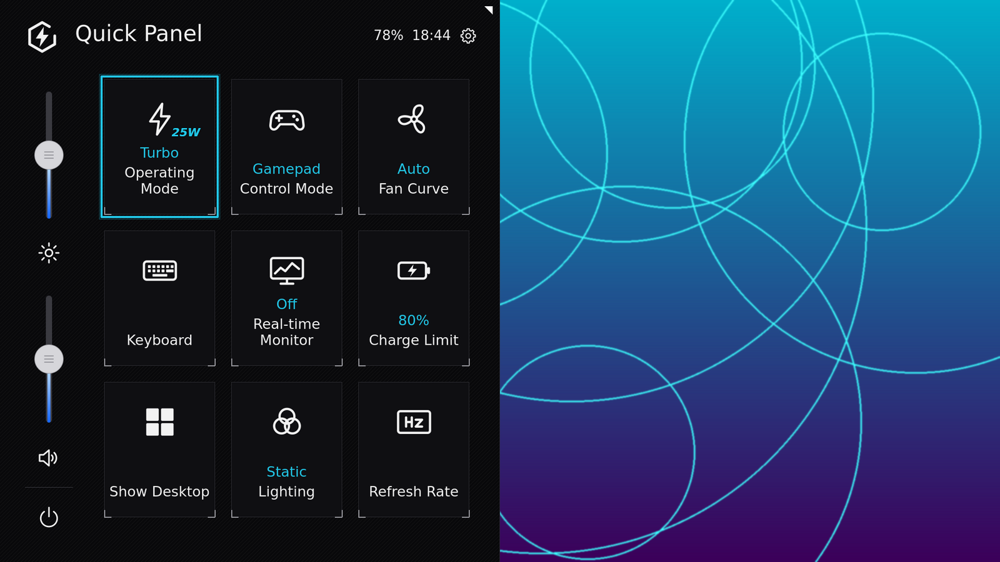
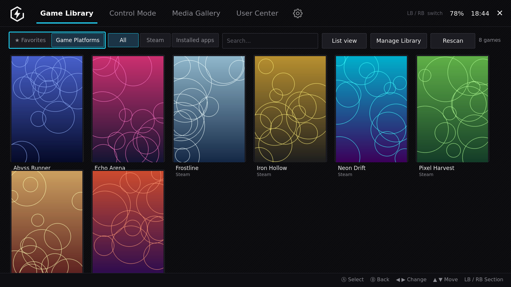
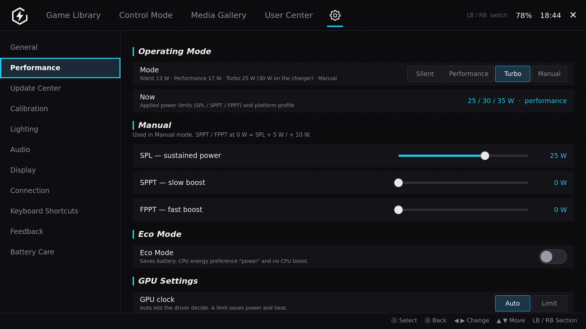
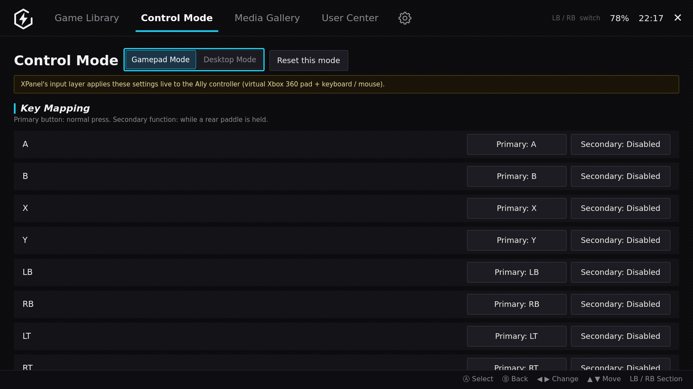
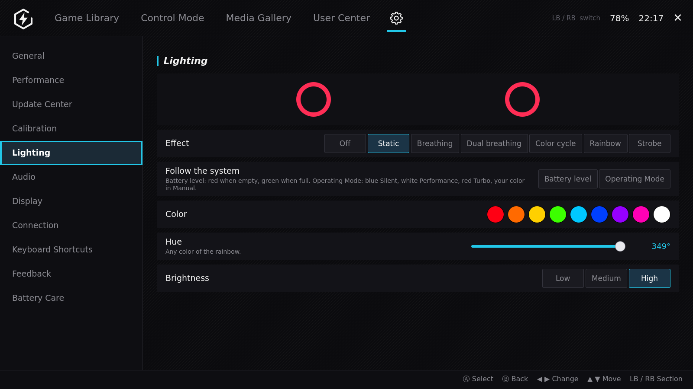
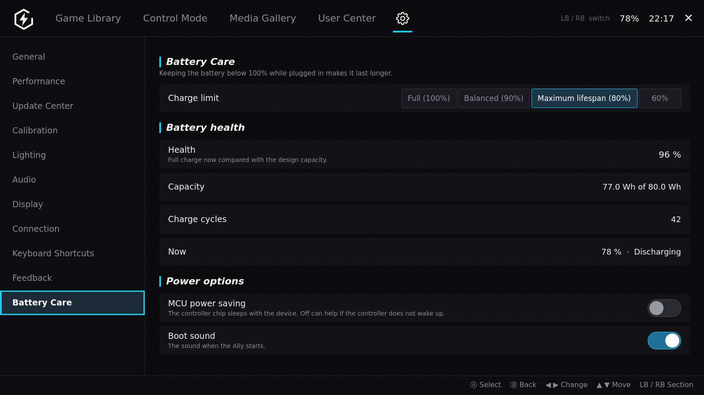
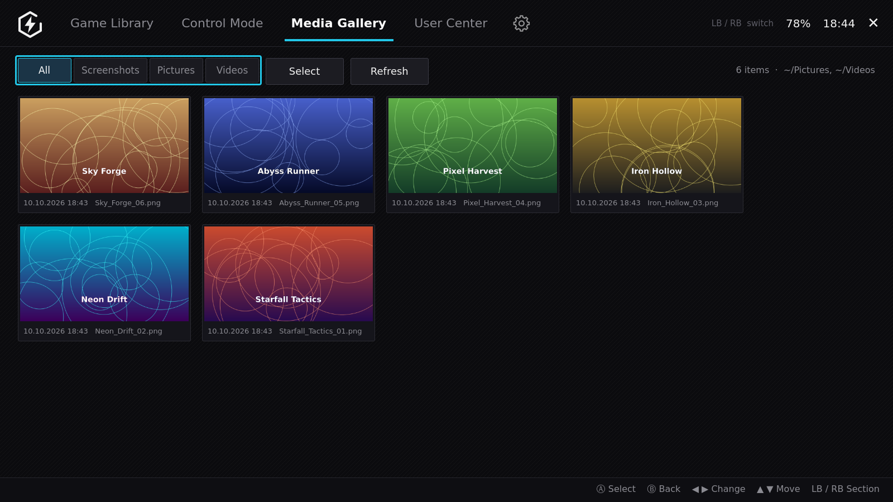
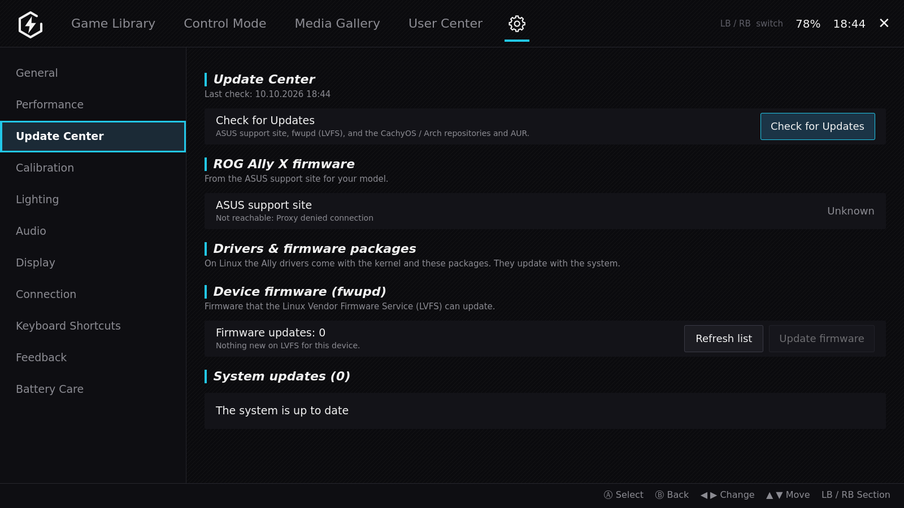
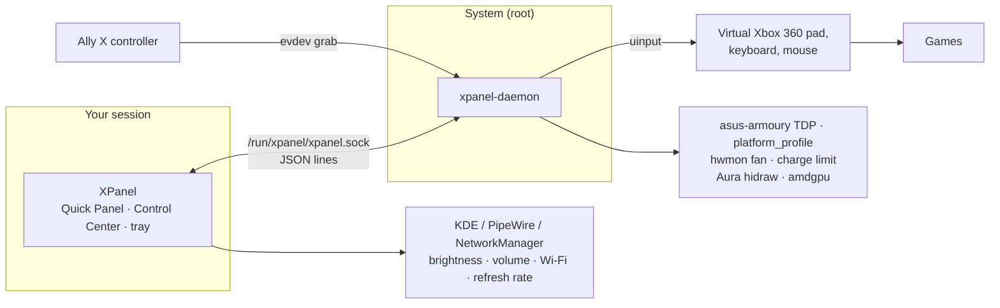

<div align="center">


# XPanel

### The Armoury Crate experience for the ROG Ally X — on Linux.

Press the Ally button: a **Quick Panel** slides in with Operating Mode, fan, charge limit,
lighting and more. Open the full **Control Center** for your game library, controller
mapping, performance tuning and battery care. Native C++ / Qt 6, made for KDE Plasma.

[](https://github.com/Adhamura/XPanel/actions/workflows/ci.yml)
[](https://github.com/Adhamura/XPanel/releases)
[](LICENSE)


[**Download**](https://github.com/Adhamura/XPanel/releases/latest) ·
[Screenshots](#screenshots) · [Why XPanel](#why-xpanel) · [Install](#install) · [FAQ](#faq)



</div>

> [!NOTE]
> **Not affiliated with ASUS.** XPanel is an independent open-source project. ASUS, ROG, ROG Ally
> and Armoury Crate are trademarks of ASUSTeK Computer Inc. and are used only to name the hardware
> and the Windows app that XPanel's layout follows.

## Why XPanel

On Windows the ROG Ally has **Armoury Crate**. On Linux there is no Armoury Crate, and the
alternatives are either inside Steam's Game Mode or a set of separate tools. XPanel brings the
familiar Armoury Crate layout to the Linux desktop as one app:

- **🎮 One button, everything there.** The Ally's menu button opens a Quick Panel over your game,
  fully driven by the gamepad (D-pad, A, B, LB/RB). No mouse, no Steam overlay needed.
- **⚡ Operating Modes like on Windows.** Silent 13 W · Performance 17 W · Turbo 25 W
  (**30 W on the charger**) · Manual with separate SPL / SPPT / FPPT.
- **🔌 Settings that stay set.** The daemon re-applies your mode when you plug or unplug the
  charger, and when the firmware or another tool changes the TDP behind your back.
- **🗂️ A real Control Center.** Game Library with per-game mode, TDP and control preset; Media
  Gallery for your screenshots and clips; Settings for performance, lighting, audio, display,
  connections, shortcuts, updates and battery care.
- **🕹️ Its own controller layer.** Remap every button, add a second function while a back paddle
  is held, button repeat, stick and trigger curves, vibration strength, and a Desktop Mode that
  turns the pad into mouse and keyboard. Applied live, no InputPlumber or hhd needed.
- **🔋 Battery care.** Charge limit (e.g. 80 %), battery health, capacity and charge cycles.
- **🌈 Aura lighting.** Static, breathing, color cycle and rainbow on the stick rings.
- **🪶 Native and small.** About 7k lines of C++17 / QML. No Python, Electron or web runtime.
  A small root daemon on a local socket does the hardware work.

## Screenshots

<table>
  <tr>
    <td width="50%"><br><b>Game Library</b> — Steam and installed apps, per-game Operating Mode, TDP and controls</td>
    <td width="50%"><br><b>Performance</b> — Operating Mode, live applied limits, manual SPL / SPPT / FPPT, Eco Mode, GPU clock</td>
  </tr>
  <tr>
    <td><br><b>Control Mode</b> — Gamepad / Desktop presets, key mapping with paddle-held secondary functions</td>
    <td><br><b>Lighting</b> — Aura effects, colors and brightness for the stick rings</td>
  </tr>
  <tr>
    <td><br><b>Battery Care</b> — charge limit, battery health, cycles, power options</td>
    <td><br><b>Media Gallery</b> — screenshots and recordings: open, share, show in folder, delete</td>
  </tr>
  <tr>
    <td colspan="2" align="center"><br><b>Update Center</b> — system packages, device firmware (fwupd) and the Ally X BIOS from ASUS</td>
  </tr>
</table>

<sub>Screenshots are made with demo data (made-up games) by <code>tools/screenshots/capture.sh</code>.</sub>

## How it compares

| | **XPanel** | Handheld Daemon (hhd) | Decky TDP plugins | asusctl / ROG Control Center | Armoury Crate |
|---|:-:|:-:|:-:|:-:|:-:|
| Runs on Linux | ✅ | ✅ | ✅ | ✅ | ❌ Windows only |
| Armoury Crate–style Quick Panel + Control Center | ✅ | ➖ | ❌ | ➖ | ✅ |
| Opens on the Ally button in the **KDE desktop** | ✅ | ➖ | ❌ | ❌ | — |
| Works without Steam / Game Mode | ✅ | ✅ | ❌ | ✅ | — |
| Operating Modes + manual SPL / SPPT / FPPT | ✅ | ✅ | ✅ | ➖ | ✅ |
| Re-applies TDP on charger plug / unplug | ✅ | ➖ | ➖ | ➖ | — |
| Charge limit | ✅ | ✅ | ➖ | ✅ | ✅ |
| Aura lighting | ✅ | ✅ | ➖ | ➖ | ✅ |
| Button remapping, paddle-held second functions | ✅ | ➖ | ❌ | ❌ | ✅ |
| Game Library with per-game profiles | ✅ | ❌ | ➖ | ❌ | ✅ |
| Media Gallery | ✅ | ❌ | ❌ | ❌ | ✅ |
| Native app, no Python / web runtime | ✅ | ❌ | ❌ | ✅ | — |
| Steam Game Mode (gamescope) | ❌ not yet | ✅ | ✅ | ➖ | — |

<sub>✅ yes · ➖ partial, or depends on setup · ❌ no. Based on each project's public documentation;
corrections are welcome in an issue. hhd is great in Steam Game Mode — XPanel is for people who
use the Ally as a <b>Linux desktop</b> and miss Armoury Crate.</sub>

## Requirements

- **ROG Ally X** (RC72LA). The original ROG Ally is not supported yet (different controller IDs
  and power limits); test reports are welcome.
- **Linux x86_64** with **KDE Plasma 6** (Wayland or X11). Developed on CachyOS; Arch, Fedora
  KDE and other Plasma 6 distros should work.
- A kernel with the **`asus-armoury`** driver (e.g. the CachyOS kernel) for TDP and BIOS settings.
- **Qt 6** (≥ 6.8 for the release archive, ≥ 6.5 from source), `layer-shell-qt` for the Wayland overlay.
- Optional, for the matching tiles and settings: `wireplumber` (`wpctl`), NetworkManager,
  `bluez-utils`, `kscreen`, `spectacle`, `fwupd`, `pacman-contrib`.

There is **no Windows build** (on Windows, use Armoury Crate) and **no 32-bit build** (the Ally X
is a 64-bit device, and XPanel uses Linux kernel interfaces such as sysfs, hidraw and uinput).

## Install

### Release archive (recommended)

Download `xpanel-<version>-linux-x86_64.tar.gz` from
[**Releases**](https://github.com/Adhamura/XPanel/releases/latest), then:

```bash
tar xzf xpanel-*-linux-x86_64.tar.gz && cd xpanel-*-linux-x86_64
scripts/install.sh                             # app, tray icon, autostart (your user)
sudo scripts/install-daemon.sh --disable-hhd   # root service; stops hhd (it changes the same hardware)
```

Distro packages for Qt, on Arch / CachyOS: `sudo pacman -S qt6-base qt6-declarative qt6-svg layer-shell-qt`.

`install-daemon.sh` creates the group `xpanel` and adds your user to it. Only members of this
group can use the daemon, so **log out and in again** (or reboot) once after the first install.

### Arch / CachyOS package

```bash
cd packaging/arch && makepkg -si
sudo systemctl enable --now xpanel-daemon
sudo usermod -aG xpanel $USER   # only if makepkg did not say it added you; then log out and in
```

### From source

```bash
./run.sh --version                             # build (CMake + Ninja), then print the version
scripts/install.sh
sudo scripts/install-daemon.sh --disable-hhd
```

Run from the source folder without installing: `./run.sh`.
Remove: `scripts/uninstall.sh` and `sudo scripts/uninstall-daemon.sh`.

### Build a release archive yourself

```bash
./build-release.sh               # uses this system's Qt → dist/xpanel-<version>-linux-x86_64.tar.gz
./build-release.sh --container   # builds in debian:trixie with Docker / Podman, like CI
```

On Windows, `build-release.bat` runs the same script inside WSL. To publish a GitHub release,
run **Actions → Release → Run workflow** on `main` (it tags `v<version>` from `CMakeLists.txt`), or
push a `v*` tag.

## Using XPanel

| Pad | Keyboard | Action |
|---|---|---|
| Left menu button (or right, from the tray menu) | Meta+Shift+Q | open / close the Quick Panel |
| D-pad | Arrows | move |
| A | Enter / Space | change the tile value / select |
| B | Esc | back / close |
| X | — | open the Control Center (Settings) |
| Y | E | edit the Quick Panel tiles |
| LB / RB | PgUp / PgDn | volume (panel) · switch section (Control Center) |

Tiles change on each press (Silent → Performance → Turbo → Manual → Silent). The Control Center
also opens from the gear icon, the tray menu, Meta+Shift+C or `XPanel --app [page]`, where page
is `library`, `control`, `gallery`, `user`, `settings` or `settings/<section>`.
Settings are kept in `~/.config/XPanel/config.json`.

## How it works



| Part | Runs as | Does |
|---|---|---|
| `XPanel` (`src/`, `qml/`) | user | Quick Panel, Control Center, tray icon; brightness, volume, refresh rate, radios, sensors |
| `xpanel-daemon` (`daemon/`) | root (systemd) | Operating Mode / TDP, fan, charge limit, lighting, input layer; saves and restores them |

<details>
<summary>Hardware interfaces and daemon protocol</summary>

- **Operating Mode / TDP:** `/sys/firmware/acpi/platform_profile` and
  `/sys/class/firmware-attributes/asus-armoury/attributes/ppt_pl{1,2,3}_*`.
  The watt values per mode are our choice, close to the ASUS defaults on Windows.
- **Fan:** hwmon `asus_custom_fan_curve` (Auto = firmware curve, Quiet, Max).
- **Charge limit:** `BAT0/charge_control_end_threshold`.
- **Lighting:** ASUS Aura HID output reports (report id `0x5A`) on the N-KEY hidraw node with
  vendor usage page `0xFF31`.
- **Input layer:** the daemon grabs the Ally X pad (USB `0b05:1b4c`) with evdev and sends a
  virtual Xbox 360 pad, keyboard and mouse through uinput, with the mapping from Control Mode.
  While the Quick Panel is open, the pad drives XPanel instead of the game. The raw pad nodes are
  hidden from games while the daemon runs and restored by udev when it stops.
- **Desktop:** KDE brightness D-Bus, KWin, kglobalaccel, `wpctl`, `kscreen-doctor`, `nmcli`,
  `bluetoothctl`, `spectacle`.

Protocol on `/run/xpanel/xpanel.sock`, one JSON object per line:
`{"get":true}`, `{"set":{"opmode":"turbo"}}` → `{"state":{...}}` (also pushed on each change).
See the top of `daemon/main.cpp` for all keys.
</details>

## FAQ

**Does it work on Windows?** No — on Windows, use Armoury Crate. XPanel exists because Linux has
no Armoury Crate.

**Does it conflict with Handheld Daemon (hhd), InputPlumber or Decky TDP plugins?** Yes, they
change the same hardware. `install-daemon.sh --disable-hhd` stops hhd, and `uninstall-daemon.sh`
tells you how to turn it back on. Don't run a Decky TDP plugin at the same time. If InputPlumber
holds the controller, Control Mode shows it as busy.

**Does it work in Steam Game Mode (Bazzite / SteamOS / ChimeraOS)?** Not yet. XPanel is for the
KDE Plasma desktop session.

**Is it safe?** The root daemon only listens on a local socket and only accepts a fixed,
validated set of settings (TDP between 5 and 40 W, charge limit 50–100 %, …). Only root and
members of group `xpanel` can use the socket, and the systemd unit sandboxes the daemon. Wattages
stay close to ASUS's Windows defaults. See [SECURITY.md](SECURITY.md) for details and known
limits. As with any tool that changes power limits: use at your own risk.

**XPanel says the daemon is not running, but it is.** Your user is probably not in group
`xpanel` yet, or you did not log in again after you joined it. Check with `id -nG`, then run
`sudo usermod -aG xpanel $USER` and log out and in. `journalctl -u xpanel-daemon -b` shows
"refused uid …" for clients that the daemon rejects.

**The controller stopped working in games.** Restart the daemon:
`sudo systemctl restart xpanel-daemon`. If you stopped it, udev restores the normal controller
(`sudo udevadm trigger --action=change --subsystem-match=input`).

**Is gyro supported?** The gyro settings are saved, but not applied yet. Calibration is not
available yet either. There is no FPS limiter (KDE has no global one).

**Does the per-game profile apply when I start a game from Steam?** Only when you start the game
from XPanel's Game Library for now.

## Roadmap

- **1.0** — ROG Ally X on KDE Plasma: Quick Panel, Control Center, Operating Modes, fan, charge
  limit, lighting, controller layer, release archive and Arch package.
- **1.1** — Original ROG Ally (Z1 / Z1 Extreme) power limits and controller; per-game profiles
  for games started from Steam, restored when the game ends.
- **1.2** — Gyro (aim and mouse), custom fan curve editor, more Aura effects.
- **Later** — Steam Game Mode (gamescope), GNOME, translations, other ASUS handhelds.

Ideas and Armoury Crate features you miss: [open an issue](https://github.com/Adhamura/XPanel/issues/new/choose).

## Contributing

Bug reports with your device, distro, kernel and `journalctl -u xpanel-daemon -b` output help
most. For code: `./run.sh` builds and runs; CI builds on Debian 13 (Qt 6.8) and Arch (latest Qt).
`tools/mapper.sh` maps controller input codes, and `tools/screenshots/capture.sh` makes the
README screenshots without an Ally.

## License

MIT. See [LICENSE](LICENSE).
